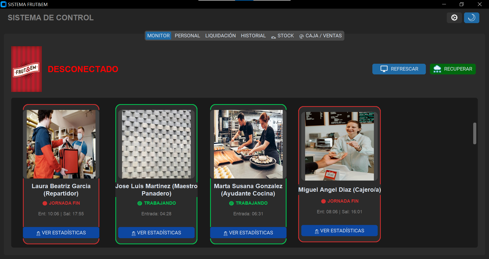
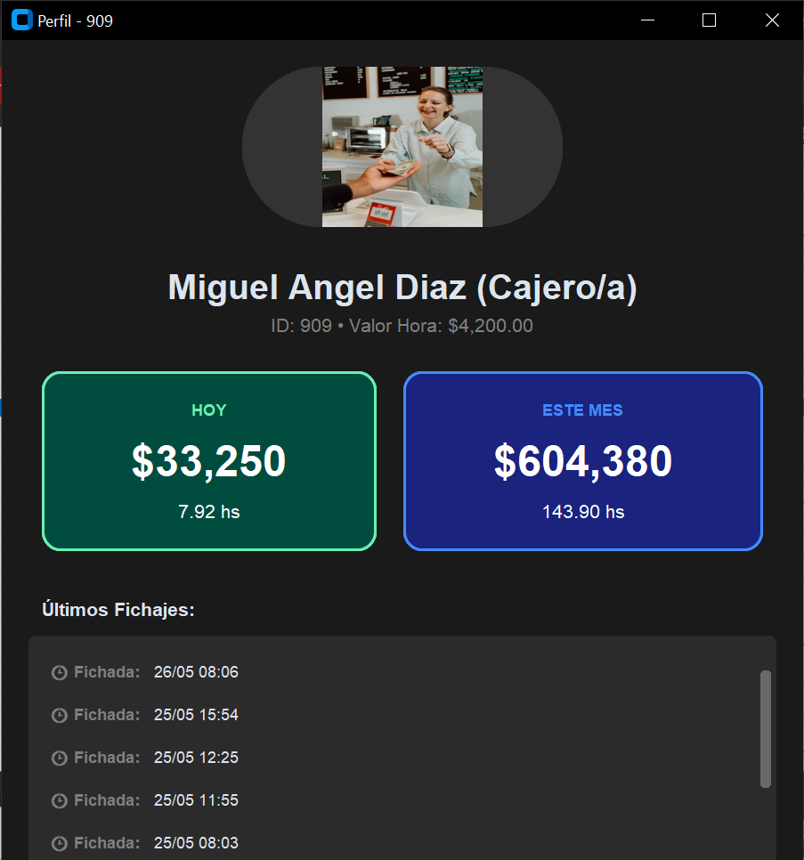
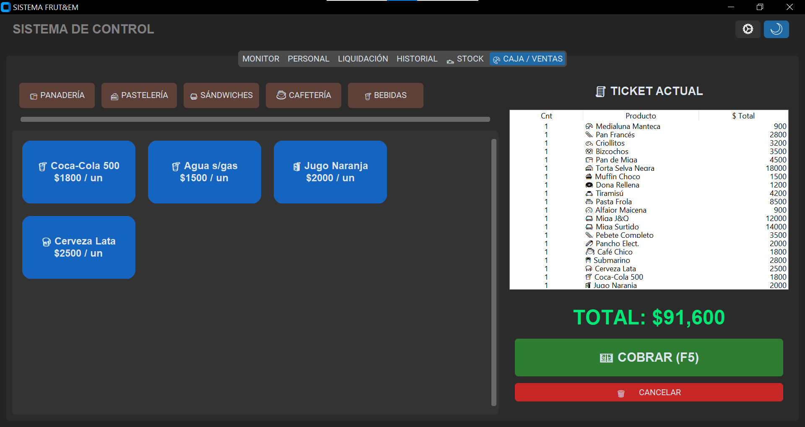
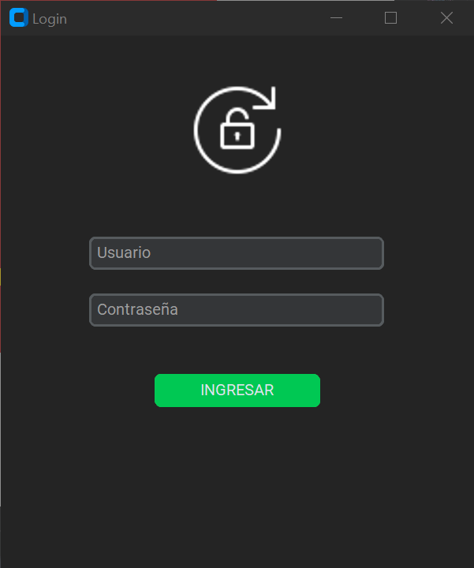
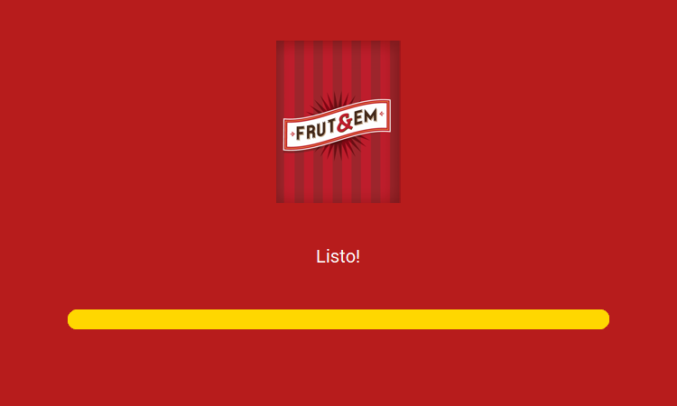

# Sistema Frut&Em

Sistema de gestión para una panadería y cafetería que integra control de personal, fichadas, liquidación de sueldos y caja/ventas en una aplicación de escritorio para Windows.



## Qué resuelve

- Registro de entradas y salidas desde reloj biométrico Hikvision.
- Monitor visual del estado de cada empleado: trabajando, jornada finalizada o desconectado.
- Fichas de personal con rol, foto, horas trabajadas y acumulados.
- Liquidación por rango de fechas con cálculo de horas y total a pagar.
- Exportación de liquidaciones a Excel, PDF y TXT.
- Gestión de productos, stock y caja/ventas con ticket actual.
- Carga de datos demo de cuatro meses para presentar el sistema.
- Fotos de demostración asociadas al rol: cajera, panadero, cocina, mostrador, limpieza y reparto.

## Galería

| Monitor | Perfil de empleado |
| --- | --- |
|  |  |

| Caja y ventas | Login |
| --- | --- |
|  |  |



## Tecnologías

- Python 3.10+
- CustomTkinter y Tkinter
- MySQL para empleados, fichadas, stock y ventas
- Pillow para imágenes de empleados y recursos visuales
- Pandas y OpenPyXL para Excel
- ReportLab para PDF
- SDK Hikvision opcional para integración con el reloj biométrico

## Instalación en Windows

1. Instalar Python 3.10 o superior y MySQL.
2. Crear un entorno virtual e instalar dependencias:

```powershell
python -m venv venv
.\venv\Scripts\Activate.ps1
python -m pip install -r requirements.txt
```

3. Crear la configuración local:

```powershell
Copy-Item config.example.json config.json
```

Editar `config.json` con los datos reales de MySQL y del reloj. Este archivo está ignorado por Git para evitar publicar credenciales.

4. Ejecutar:

```powershell
python main.py
```

También se puede usar `setup_frutem.bat` para instalar el entorno y `run_frutem.bat` para iniciar la aplicación.

## Datos de demostración

Con MySQL iniciado y `config.json` configurado, el proyecto incluye scripts para preparar una presentación:

```powershell
python cargar_demo_4_meses.py
python ajustar_fotos_por_rol_demo.py
```

Estos scripts crean empleados ficticios, fichadas de los últimos cuatro meses y asignan imágenes demo según el rol. No contienen datos personales reales.

## Integración con el reloj

La comunicación con el dispositivo Hikvision requiere colocar el SDK correspondiente junto al ejecutable o en la carpeta del proyecto. Por motivos de tamaño y distribución, las DLL propietarias no se incluyen en este repositorio. La aplicación puede abrirse y trabajar con la base MySQL sin conexión al reloj; en ese modo se pueden usar las cargas demo.

## Estructura principal

```text
main.py                  Interfaz y navegación principal
motor.py                 Persistencia MySQL e integración con Hikvision
reportes.py              Exportaciones Excel, PDF y TXT
config.py                Rutas y configuración de la aplicación
cargar_demo_4_meses.py   Datos ficticios para demostración
fotos_personal/          Imágenes demo clasificadas por rol
iconos/                  Iconos y recursos de la interfaz
docs/screenshots/        Capturas para documentación y portfolio
```

## Estado del proyecto

Proyecto de portfolio y demostración funcional. Antes de usarlo en producción se recomienda cambiar todas las credenciales, restringir el acceso a MySQL y validar la configuración legal de liquidaciones según el país.
